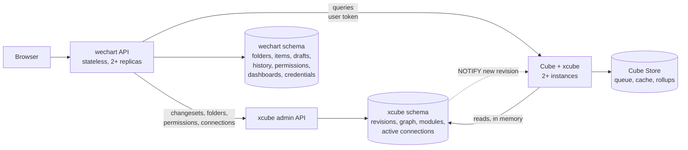

> **Snapshot** of the user's shared doc "wechart ↔ Cube integration plan" (https://claude.ai/code/artifact/18e15cb7-61fe-4f04-9a33-d6f3eef664b8), read through the Claude Docs connector on 2026-09-26 at revision 59 and converted to Markdown. The live doc stays the source of truth; this is the record `docs/requirements.md` cites as `[plan]`. Raw input for project-interview, as `2026-09-26-integration-plan-decisions.md` asks.

# wechart ↔ Cube integration plan

2026-09-25 · @Poongodi Raju

wechart keeps every record people author and manage; xcube, running inside an unmodified Cube, turns published records into modules of cubes that compile and query independently, so adding or changing a cube recompiles only its module. Every mechanism below was checked in Cube 1.7.45's code and proven in spikes; this is the plan to build from.

## How it fits together

wechart publishes changes to xcube; xcube resolves names, groups cubes into modules, compiles only the modules a change touches, and serves queries module by module; Cube never calls wechart.

- **wechart** is the system of record: folders, cubes and views as people write them, drafts, workspaces, proposals, the 10-version history, permissions, dashboards and encrypted credentials.
- **xcube** is a package inside every Cube instance and the refresh worker. It holds a runtime projection of what is published: resolved items, the reference graph, modules and active connections, in its own schema.
- **Cube Core** compiles and runs queries, unmodified.
- The projection is derived: if xcube's schema is lost, wechart re-sends a full snapshot and xcube rebuilds it.

## Who owns what

wechart owns everything people author, manage or approve; xcube owns everything Cube needs at runtime, derived from what wechart publishes; neither reads the other's tables.

|  | wechart | xcube | Cube Core |
|---|---|---|---|
| **Records** | Folders (tree, ids), cube and view items as written, data source records, permissions, drafts, workspaces, proposals, approvals, 10-version history, dashboards, audit | Published revisions: resolved items, reference graph, module membership and versions, folder groups, active connections (ciphertext) | — |
| **Rules** | Workflow, approvals, who may see and edit what | Name resolution, module grouping, validation, generated access policies, Cube's schema and policy answers | Compiling, planning, access policy evaluation |
| **Runtime** | Signs tokens (RS256, JWKS); routes browser requests | `repositoryFactory`, `schemaVersion`, `contextToAppId`, `extendContext` routing, `driverFactory` with swappable drivers, health, catalog reads | Queries, queue, cache, pre-aggregations |
| **Secrets** | Stores credentials encrypted to xcube's public key; cannot decrypt | Holds the private key; decrypts only to build a driver | — |
| **Storage** | wechart schema | `xcube` schema, own database role, same Postgres cluster to start | Cube Store |

Why not have xcube own everything: workflow, history, permissions and UI are product logic that would be rebuilt in xcube and duplicated across two systems. Why not have wechart own the runtime: Cube would depend on wechart's API on every query, the original availability problem.

## Names

Every cube, view and data source gets a unique name made of a stable folder id and its short name, so the whole deployment is one flat namespace and nothing clashes.

- **Stable folder ids, not paths:** a name is `<folderId>__<shortName>`, for example `f7k2__orders`. Renaming or moving a folder changes nothing Cube sees, so no cube is renamed, no dashboard breaks and no rollup is rebuilt.
- **People see short names:** xcube sets each cube's and member's `title` from the short name, and wechart shows the folder path beside it.
- **Short aliases for the database:** a rollup's table name is built from the cube and rollup names (`BaseQuery.js:4401`), and Postgres refuses names over 63 characters (`PostgresDriver.ts:445`). xcube sets a short, stable `sql_alias` on every cube and pre-aggregation (both supported, `CubeValidator.ts:555, 1177`).
- **Resolution at publish:** a short name inside an item (a join to `orders`, `data_source: warehouse`) resolves nearest-first from the item's own folder toward the root, and is stored in the resolved item as the full name. A cube with no data source takes the nearest `default` (AC-310).
- **Overrides:** a child folder overrides a parent's `orders` by publishing its own `orders`; items in that child bind to it when they are next published. There is no viewer-folder binding (AC-309 is superseded).
- **Deletes and renames** of a short name are refused while another published item still references it; the error names those items.

## Modules

A module is a group of cubes and views that reference each other; each module compiles on its own, so a change recompiles only the module it touches. Proven on stock Cube (spike D): adding a cube in a new module compiled that module alone, and other modules compiled nothing.

**The reference graph** (built by xcube at publish, from the resolved items)

- Nodes: every cube and view.
- Edges: joins; a view to each cube on its join paths and in its members; `extends`; `{cube.member}` references in SQL, segments and measures; pre-aggregations that reference other cubes.
- **Shared cubes** (a date or customer dimension used by many groups) get no grouping edges, or they would glue everything into one module. A cube is shared when groups in different folder subtrees reference it, with a manual override. Each module that uses a shared cube compiles a copy of it; the shared cubes also form a **commons module** of their own.

**Grouping** (connected components with union-find)

1. Adding items or references only merges groups: union them.
2. Removing an item or reference can split a group: re-walk only that group's stored graph.
3. Module ids stay stable: on a merge the larger group keeps its id; on a split the largest piece keeps it.
4. Tiny groups are packed into modules of a few hundred cubes, preferring the same folder, so the number of compiled models stays low.
5. A publish bumps the version of every module whose members or content changed, including modules holding a copy of a changed shared cube. Only those are compiled.

**App ids and routing**

- Cube's app id is `m:<moduleId>@<moduleVersion>`; `repositoryFactory` returns that module's files. Unchanged modules keep their app id and stay compiled.
- Cube's `extendContext` sees each request; xcube reads the query's members, finds their module in its in-memory member → module map, and sets it on the context, so `contextToAppId` picks it (`gateway.ts:2481`, `server.ts:533`). wechart just sends queries.
- Requests with no members (meta, jobs, a query on shared cubes only) name the module or go to the commons module; the jobs API carries it in the security context.
- **A query spanning modules** (two facts joined through a shared dimension) compiles an on-demand union of those modules under app id `u:<m1>+<m2>@<versions>`, cached like any other; a published view that includes both facts merges them into one module permanently.
- **Meta:** xcube merges each module's meta for the field list, filtered by permissions.
- **Refresh worker:** one context per module via `scheduledRefreshContexts` (`RefreshScheduler.ts:259` keeps the module). A rollup on a shared cube is built once, not per module (spike D: one table).

## Flows

Four flows cover everything: publish, query, preview and connection change.

**Publish** (a proposal is approved in wechart)

1. wechart sends a changeset: items to upsert or delete (folder id, short name, YAML as written), with the revision it was based on.
2. xcube resolves short names, updates the graph, regroups modules, and generates access policies from folder groups.
3. xcube compiles each affected module in a throwaway compiler and runs its extra checks. Any error refuses the whole changeset and names the item, line and column.
4. On success it stores the new revision and module versions in one transaction and sends `NOTIFY`.
5. Every Cube instance compiles the changed modules in the background, then switches to them. Queries keep using the old versions until then.

**Query**

1. wechart sends a user token (RS256, groups) and the query to any Cube instance.
2. xcube's `extendContext` maps the members to a module; Cube uses that module's compiled model and enforces its access policies.
3. A slow query answers `Continue wait`; the next poll may reach another instance and still finds it, because the queue is in Cube Store.

**Preview** (a workspace or proposal)

1. wechart sends the overlay: changed items with an expiry.
2. A query naming the overlay compiles only the affected modules with the overlay applied: a fraction of a second, since modules are small.
3. The overlay is removed on publish, discard or expiry.

**Connection change**

1. wechart sends the connection's settings and credential ciphertext (encrypted to xcube's public key).
2. xcube tests it, then swaps the driver behind a stable per-connection wrapper: running queries finish on the old connection, new ones use the new one, old pools close.
3. A change of database type is handled as a publish, because the SQL dialect is fixed at compile.

## The contract

wechart and xcube meet only at xcube's HTTP routes; xcube keeps to what needs Cube's runtime or code, so Cube-side customization stays small. Paths are a draft for both teams to settle.

**Admin API** (service credential, audience `xcube-admin`; wechart's server only)

| Route | Does | Need |
|---|---|---|
| `POST /v1/semantic/changesets` | Validates and applies items to upsert or delete; refuses `409` on a stale base revision; `?dryRun=true` validates only. | Core |
| `PUT /v1/semantic/snapshot` | Replaces the whole projection: first import and disaster recovery. | Core |
| `PUT /v1/semantic/folders` | Folder tree (ids, parents) and each folder's allowed groups. | Core |
| `GET /v1/semantic/revision` | Current revision and whether every instance has switched to it. | Core |
| `PUT`, `DELETE /v1/semantic/overlays/{id}` | Workspace or proposal items, with an expiry. | Core |
| `GET /v1/semantic/meta` | Field list merged across modules, filtered by the caller's groups. | Core |
| `GET /v1/semantic/public-key` | The key wechart encrypts credentials to. | Core |
| `PUT`, `DELETE /v1/semantic/connections/{name}` | Active connection: type, settings, ciphertext; never returned in plaintext. | Core |
| `POST /v1/semantic/connections/test`, `GET …/{name}/health` | Test before saving; last test and live status. | Core |
| `GET /v1/semantic/policies`, `GET /v1/semantic/schema`, `POST /v1/semantic/refresh-keys/check` | Cube's own answers, replacing rules wechart re-implements today. | Optional, slice 7 |

**Data API** (user tokens)

- Cube's own routes: `/v1/load`, `/v1/sql`, `/v1/dry-run`; a header names an overlay when previewing.
- `/v1/introspection/*` as today (the `introspection` scope).
- `/v1/pre-aggregations/jobs` only with the service credential.

**Tokens**

- wechart signs RS256 and publishes a JWKS; xcube verifies against it and holds no signing key. New keys are published 60 s before use.
- User token: `sub`, `groups` (trimmed to groups policies name), `role: user`, `iss`, `aud: xcube`, short `exp`.
- Service token: separate client credential, `role: service`, `aud: xcube-admin`; may assert a preview context (AC-166–168).

**Storage:** each side's database role reads only its own schema; xcube announces new revisions with `NOTIFY`.

## Runtime settings

The spikes fixed these settings; every Cube process (API instances and the refresh worker) uses the same ones.

| Setting | Value | Why |
|---|---|---|
| `CUBEJS_CACHE_AND_QUEUE_DRIVER` | `cubestore` | The memory queue ran the same query twice across instances (spike C) |
| `queueOptions.heartBeatInterval` | 5–10 s | A crashed instance releases its queries in about 30 s instead of 2 minutes |
| `CUBEJS_TRANSPILATION_WORKER_THREADS_COUNT` | 4 (2 if memory is tight) | Unset, compiles peaked at 3–5 GB RSS (spike A) |
| Node heap (`--max-old-space-size`) | 4 GB or more | Resident modules plus background compiles |
| `compilerCacheSize` | modules × 2 + active previews and unions | Every active module must stay compiled |
| `maxCompilerCacheKeepAlive` | about 10 minutes | Old versions and idle previews are evicted |
| `orchestratorOptions.continueWaitTimeout` | as today | No environment variable exists for it |
| One orchestrator, one pre-aggregation schema | fixed | Rollups are shared across modules; Cube's orchestrator limit (100) never applies |

## Feasibility

Every mechanism in this plan was checked in Cube 1.7.45's code and proven in a spike; spike code is on the Cube fork's throwaway branch `spike/xcube-feasibility`.

| Mechanism | Result |
|---|---|
| Per-module app ids, routing from the query, compile only the changed module (spike D) | Proven: adding a cube compiled only its module; other modules compiled nothing; a shared rollup was built once |
| Model served from xcube's schema, revision pushed by `NOTIFY` (spike C) | Proven: switch mid-query answered 200; instances within 45 ms; missed notices caught on reconnect |
| Module size and planning cost (spike A) | Planning grows with compiled size: about 25 ms at 1k cubes, 120–170 ms at 6k. Modules of a few hundred cubes keep it low |
| Previews by compiling only what changed (spike A) | 0.2–0.9 s, SQL byte-identical to a full compile |
| Connection swap behind a stable driver (spike B) | Proven: no errors, no restart, no rollup rebuild, old pools closed |
| Two instances on the Cube Store queue (spike C) | Proven: polls on either instance found the one query; results and rollups shared |
| Validation in a throwaway compiler | Proven; xcube maps errors to item and line and pre-parses YAML |
| RS256 with JWKS, per-instance health, pool release, credentials out of logs | Proven |
| Cube's schema for forms; rollup "why not used" | Partial: schema needs a curated overlay; "why not" is a hint only |

## Slices

Nine slices, each leaving both systems working; slice 3 is the heart of the change, and slice 7 is optional. Update Status as work moves.

| Slice | Status | xcube (Cube side) | wechart | Done when |
|---|---|---|---|---|
| **0. Rename and ship** | In progress | Rename `cube-introspection` to xcube; CI builds the image to a registry | Run the xcube image, pinned by digest; fix `docs/deploy.md` | wechart runs xcube from the registry; introspection tests pass |
| **1. Spikes** | Done | Scale, previews, connection swap, two instances, per-module app ids | — | All five proven (see Feasibility) |
| **2. Foundation** | Not started | `xcube` schema and migrations; service-credential auth on admin routes; revision store; `NOTIFY` listener; snapshot import; `config()` one-liner. Serves today's model as one module, behaviour unchanged | Drafts move from API memory to its database; send a snapshot at start-up; API on 2+ replicas | Cube answers with wechart's API stopped; two API replicas serve correctly |
| **3. Names and modules** | Not started | Changesets; folder-id prefixes, aliases, publish-time resolution; reference graph with union-find; per-module app ids and `extendContext` routing; background compile then switch; unions; merged meta; refresh contexts per module | Publish through changesets; push folders; migrate dashboard and chart member references to prefixed names; remove `/api/cube-model/*` and the logic in `cube.js` | Adding a cube compiles only its module; every existing dashboard renders unchanged |
| **4. Permissions and tokens** | Not started | Policies generated from folder groups; JWKS verification; role → scopes; admin and `jobs` only for the service credential | Push folder groups; sign RS256, publish JWKS, use a service credential | Cube refuses a member the groups don't allow; the shared HS256 key is retired |
| **5. Previews** | Not started | Overlays compiled per affected module | Push workspace and proposal overlays; name the overlay on preview queries | A workspace dashboard renders its unpublished changes |
| **6. Connections** | Not started | Public key; connection routes; decrypt in `driverFactory`; swappable driver per connection; pool release; per-instance health | Encrypt credentials to xcube's key; push active connections; connection screens (AC-157–164) | A connection is created, tested, browsed and queried without a restart; wechart cannot decrypt it |
| **7. Cube's answers (optional)** | Not started | Policies, schema and refresh-key routes | Use them; delete the six re-implemented rules | No Cube rule is coded in wechart |
| **8. Hardening** | Not started | Runtime settings above; contract tests run on every Cube upgrade | Load test against AC-174/175/307 targets; runbook | p95 targets met on 2+ instances with a killed instance mid-test |

wechart work goes through its own spec → research → tasks gates. xcube work stays in its directory of the Cube fork; no Cube file changes.

## What changes in wechart's docs

wechart amends these through its gates and marks the old text superseded; its session has a prompt that lists every conflict for review first.

| Item | Today | Becomes |
|---|---|---|
| AC-309 | Names in an inherited model bind in the viewer's folder | Names resolve at publish from the item's own folder |
| AC-272, 273, 310 | Nearest-first resolution per folder chain at query time | The same rules, applied at publish, stored as `<folderId>__<name>` |
| `per-folder-models.md` (Layout B), T337–T341 | One app id per folder chain, composed by wechart and `cube.js` | Modules computed by xcube; wechart publishes changesets and folders |
| Chart and dashboard documents | Reference short member names | Reference prefixed names (migrated in slice 3) |
| R14, R21, AC-298, AC-311 | Credentials decrypted with a key every API pod holds | Encrypted to xcube's public key; wechart holds no decryption key |
| T339, T361, AC-159 | `cube.js` fetches decrypted credentials; tests through a fork endpoint | xcube decrypts; tests via `POST /v1/semantic/connections/test` |
| AC-136, 137 | Draft compiled via `/v1/meta`, then files written | One changeset call that validates the affected modules and activates |

## Decisions

Sixteen decisions are made; two are open, each needed before the slice named.

**Made** (2026-09-25)

- [x] wechart is the system of record for everything people author and manage; xcube keeps a derived runtime projection in its own schema.
- [x] Cube customization stays low: xcube does only what needs Cube's runtime or code; Cube Core is unmodified.
- [x] The Cube-side package is called xcube; `/v1/introspection/*` routes stay as they are.
- [x] Names are `<folderId>__<shortName>`, using stable folder ids so renames and moves change nothing in Cube.
- [x] Short names resolve at publish, nearest-first from the item's own folder; viewer-folder binding (AC-309) is dropped.
- [x] Modules are computed by xcube from the reference graph (union-find); each compiles on its own, and a change recompiles only its modules.
- [x] Shared cubes are copied into the modules that use them; cross-module queries compile an on-demand union.
- [x] Every publish validates every module it affects; any break refuses it.
- [x] Permissions enforced twice: wechart authorizes, and Cube enforces policies xcube generates from folder groups.
- [x] Credentials stored by wechart, encrypted to xcube's public key; only xcube decrypts.
- [x] Previews reach xcube as short-lived overlays.
- [x] Scale target: 100–200 model-bearing folders, thousands of cubes; modules keep compile and planning costs flat.
- [x] Only wechart calls Cube and xcube; tokens carry groups only.
- [x] HA query path: 2+ Cube instances on the Cube Store queue; stateless wechart API on 2+ replicas; Cube Store single-node for now.
- [x] Spike code lives on a throwaway branch and is never merged.
- [x] Database: xcube has its own `xcube` schema and database role on wechart's Postgres cluster (decided 2026-09-26).

**Open**

- [ ] **Token signing rollout** (slice 4): RS256 with JWKS straight away (recommended), or HMAC rotation until end-user sign-in ships.
- [ ] **Key custody** (slice 6): where xcube's private key and wechart's signing key live (Kubernetes Secret, KMS or vault), with backup and rotation.

## Risks

Each remaining risk has a containment in the plan.

| Risk | Containment |
|---|---|
| xcube relies on a few Cube internals (compiler error fields, worker pool, gateway hooks, orchestrator storage) that can change between releases | xcube pins its Cube version and refuses to start on another; contract tests run on every upgrade (slice 8) |
| A shared cube used by many modules makes its changes recompile all of them | Shared cubes change rarely; each module compiles in under a second in the background |
| A module grows large and planning slows | Packing caps module size; a view merging many facts is flagged at publish |
| Migrating dashboard references to prefixed names | One mapping per item, done in slice 3 with a check that every existing dashboard renders unchanged |
| Losing xcube's private key makes stored credentials unusable | Key backup is part of the key-custody decision; re-entering credentials is the fallback |
| Cube Store is a single node | Accepted for now; its clustered mode is the path when query volume needs it |
| Validation line numbers for semantic errors come from xcube's mapping, not Cube | Errors always name the item; lines are best effort |

## How both teams use this doc

This doc is the source of truth for the split; each team's own repository holds the detail.

- **Contract changes** are proposed as a comment on The contract section and agreed here before either side builds them.
- **Status** lives in the Slices table; update it when a slice starts, blocks or finishes.
- **wechart** turns each slice into ACs and tasks through its own gates, citing this doc.
- **xcube** changes stay in its directory of the Cube fork, with tests; a pull request links its slice here.
- **Decisions** move from Open to Made with a date once taken.

## Basis

The plan rests on a read-only review of wechart at commit `9249ad7` and of Cube Core 1.7.45.

- **wechart:** requirements, spec and tasks; the design direction; the Cube research docs; the metadata schema and migrations; `packages/api`, `packages/web`, `packages/core`; `infra/cube/cube.js`; compose and Helm.
- **Cube:** `server-core` (`server.ts`, `OptsHandler.ts`, `OrchestratorApi.ts`, `OrchestratorStorage.ts`, `CompilerApi.ts`), the API gateway, the query orchestrator and the server container, at tag `v1.7.45`.
- **xcube:** `cube-introspection/` on branch `feat/introspection-package` (commit `0b6eef90a9`) of the Cube fork, including the side-by-side check that its API matches the image wechart runs today.

- **Feasibility runs (2026-09-25):** scripts against the published `@cubejs-backend/*` 1.7.45 packages and a throwaway Postgres, covering throwaway compiles and their errors, policy extraction, the validator schema, version switching, `LISTEN/NOTIFY`, pool release, health overrides, RS256 with JWKS, and credential leakage. Results are in the Feasibility section.
- **wechart requirements** on per-folder models, workspaces, data sources and security, and a product-owner interview that produced the decisions above.

**Answered: Cube's `SIGUSR1` reload does not re-read `cube.js`.** On `SIGUSR1` the server container shuts the instance down and builds a new one (`packages/cubejs-server/src/server/container.ts`, `start()`), which reloads `.env` with override and re-reads `cube.py`, but loads `cube.js` with `import()` of the same file URL. Node caches that module for the life of the process, so edits to `cube.js` are not seen; tested on the image's Node 24.21.0, a reload after an edit returned the old export. A reload does rebuild the server core, so compiled models, orchestrators and drivers are recreated and config functions run again. Changes to `cube.js` itself need a process restart, which the xcube design never relies on: runtime state comes from the semantic schema, not the config file.
